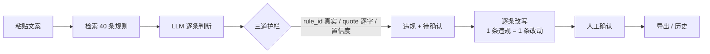
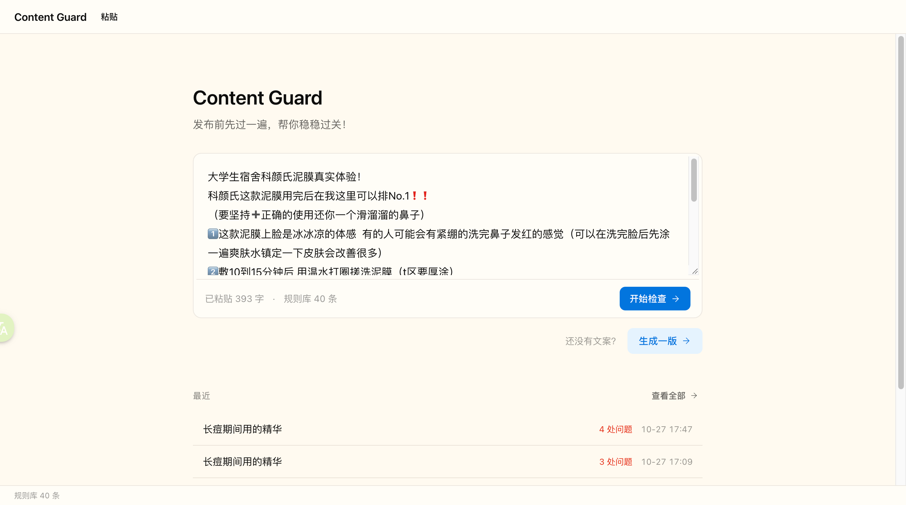
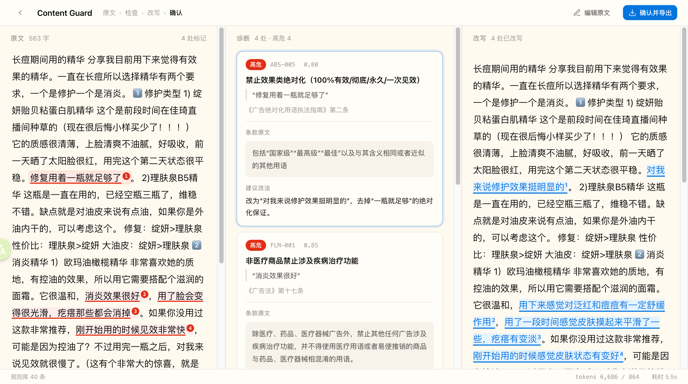
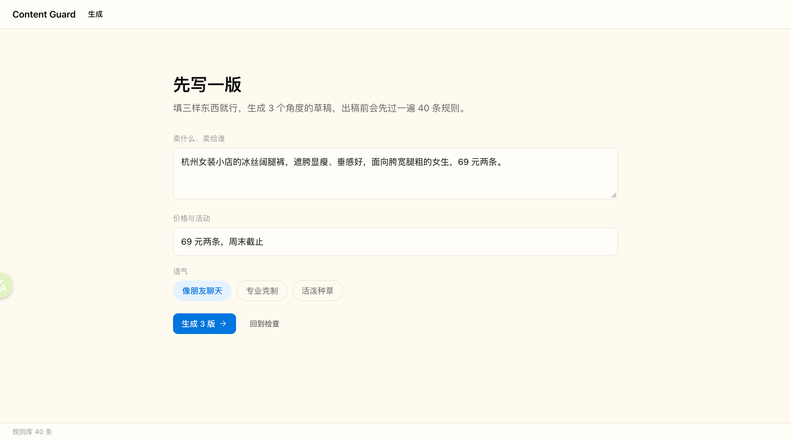
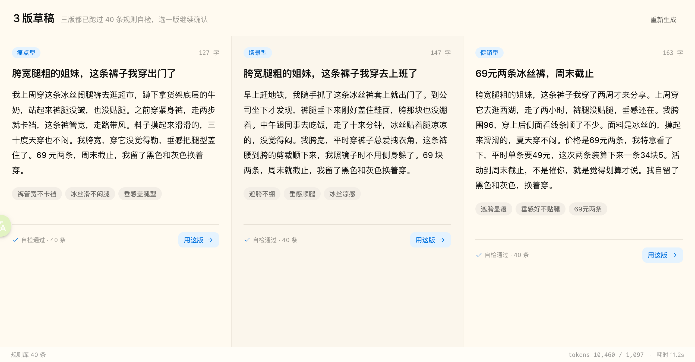
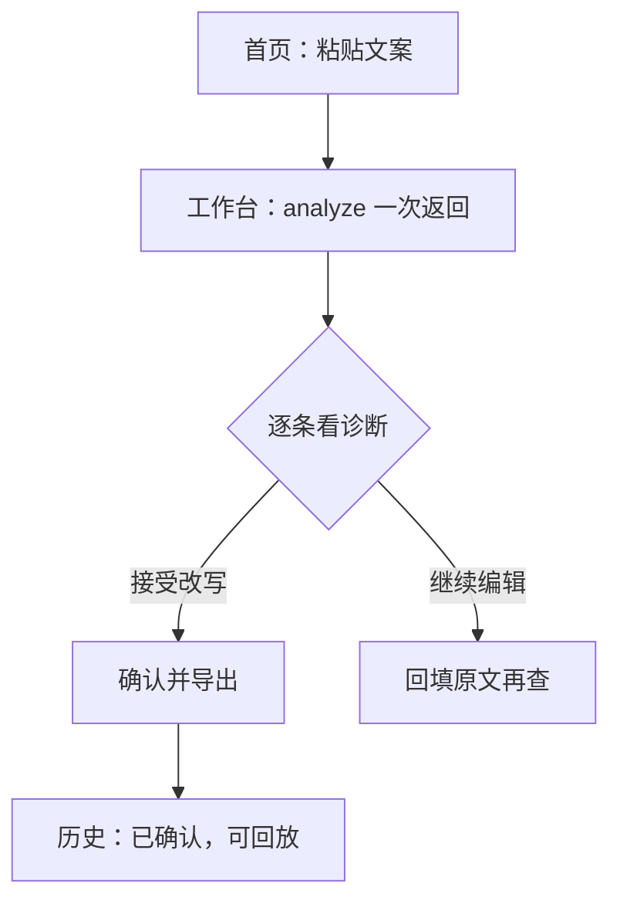
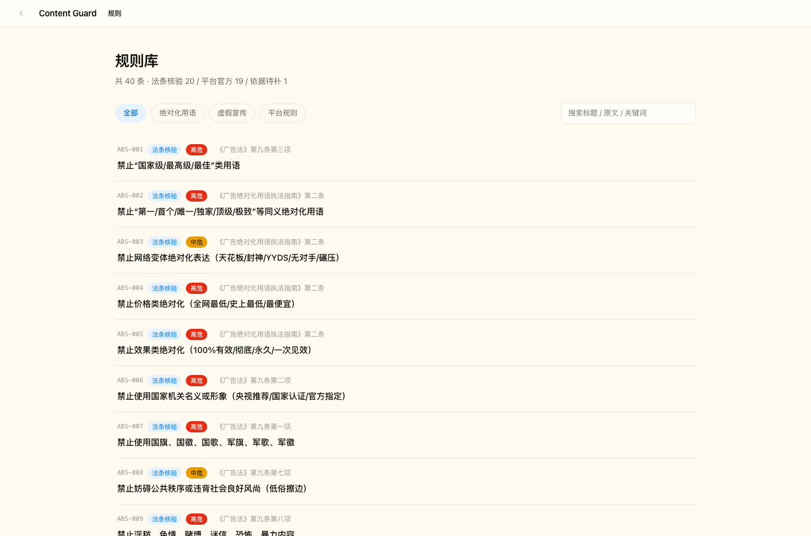
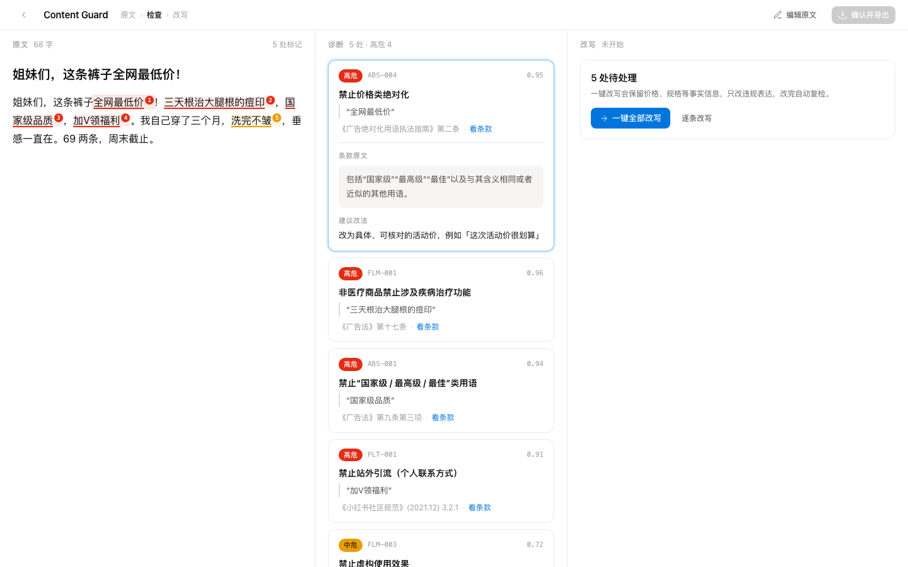

# Content Guard 产品需求文档（PRD）

| 项    | 值                                                          |
| ---- | ---------------------------------------------------------- |
| 文档版本 | v2.0（完整版，评审用）                                              |
| 产品状态 | 已上线（http://43.142.12.100/）；v1.1 判定纪律已于 2026-10-27 17:50 部署 |
| 读者   | 产品/设计/研发评审、面试官、未来的自己                                       |
| 最后更新 | 2026-10-27                                                 |
| 一句话  | 给 1–3 人小商家的「发布前合规体检」：贴文案 → 逐句判断 → 指回条款 → 逐条改写 → 人工确认       |

> 本 PRD 是上线后补写的完整版。V1（流程图 + 低保真原型）在 `designs/prototype/`，用于和设计对齐；两版差异见附录 D。

---

## 1. 需求背景

### 1.1 三个背景点

**无专人负责合规**

1–3 人的小商家团队，老板往往同时是运营、客服和内容。没有合规岗，也没人逐条读《广告法》和平台规范。文案多是自写，或从商品详情页改写。

**平台无明确理由**

发布后被限流、下架，平台通常只给一句“涉嫌违规”，不指出哪一句、违反哪一条。商家只能靠猜：改一版、再发、再被拦。

**违规成本高**

违规的成本在发布之后才显现：一条笔记的流量、账号权重，以及“还要不要继续做”的信心。所以判断必须发生在发布前，而不是事后申诉。

### 1.2 用户与场景

| 项   | 内容                              |
| --- | ------------------------------- |
| 用户  | 1–3 人小商家 / 个体买手；不懂法条，但要“这版能不能发” |
| 频率  | 检查 5–10 次/天；生成 1–2 次/天          |
| 设备  | 手机为主，桌面用于集中改稿                   |
| 非目标 | MCN、品牌合规部、需要审批流和账号级数据的企业团队      |

三个核心场景：

1. **已有文案体检（主）**：文案已写好，发布前贴进来，逐句看哪句会出事。
2. **从零生成（次）**：没有文案，给卖点生成 3 版；生成结果必须已自检，不能“生成完再查”。
3. **改完确认**：按建议改完，确认并导出；查过即进历史。

**证据来源**：作者本人是第一个用户；`docs/log.md` 记录了真实反馈（如“检查出 2 处、改写冒出 3 处，数量对不上”）；另有 24 条真实笔记做评测。**没有外部用户访谈**，以上用户画像标为“待验证假设”。

### 1.3 替代方案

| 方案          | 能给什么      | 缺什么                  |
| ----------- | --------- | -------------------- |
| 人工自查 / 平台提示 | 有判断，但依赖经验 | 平台不说具体理由；不可追溯        |
| 词表类工具       | 命中敏感词     | 只给词，不给条款和改写；语境误报多    |
| 通用大模型       | 能写能改      | 结论不稳定、不能对账、不方便查看历史记录 |

我们的差异不在“能生成”，在“每条判断都能指回原句和条款，并且改动能对账”。

---

## 2. 需求概述

### 2.1 一句话定位

**发布前的合规判断与修订，不是 AI 文案生成器。**

核心链路四步：

### 2.2 关键取舍

| #   | 决策               | 理由                               | 代价                       |
| --- | ---------------- | -------------------------------- | ------------------------ |
| 1   | 检查功能是内核，生成功能只是辅助 | 高频动作是“这版能不能发”；生成功能不构成差异          | 生成入口权重低                  |
| 2   | 生成即自检            | 不给用户“挖坑再卖梯子”；生成物直接就能发            | 一次生成最多 12 次模型调用          |
| 3   | 一次算完：检查 + 改写同一请求 | 两次请求结果可能会漂移，出现“检查 2 处、改写 3 处”的情况 | 单次 3 次调用；改写失败不能丢检查结果     |
| 4   | 改动数 = 违规数，编号 1:1 | 用户能逐条对照，不出现“多改一条”                | 改不了的只能标“未自动改写”           |
| 5   | 每条违规带条款原文和出处     | 合规要可审计；商家能自己复核                   | 护栏会丢弃编造的 rule_id / quote |
| 6   | 页面数字必须来自后端       | 假数字经不起考验                         | 前端不能用默认值；mock 宁可不显示      |
| 7   | 不做登录，匿名设备号       | 降低门槛；demo 阶段不做账号体系               | 换浏览器看不到历史；header 可伪造     |

### 2.3 双入口与三栏工作台

- **入口 A 粘贴检查（主）**：首屏一个大输入框，按钮“开始检查”。
- **入口 B 从零生成（次）**：一行小字入口；生成 → 自检 → 自动改写 → 复检，通过才展示。
- **工作台三栏**：原文（红标 + 编号）｜诊断（规则、条款原文、建议）｜改写（蓝字 + 编号）。条款内联，不做抽屉；编号三栏共用。

从零生成入口：

---

## 3. 优先级划分

### 3.1 P0 · 已上线

- 粘贴检查 → 逐条判断 → 条款内联 → 逐条改写 → 确认导出
- 生成即自检（自检 + 自动改写 ≤2 轮 + 复检）
- 历史事件流 + 匿名设备号隔离；点开恢复
- 规则库 40 条（逐字可溯源）+ 规则校验 CI
- 限流 10 次/分钟；每日备份保留 14 天

### 3.2 P1 · 下一步

- 工作台“待确认”区：把 `uncertain` / `human_review` 展示出来（当前页面不展示）
- 检索修复：长文分段 / 按句召回，解决“规则在库里但没被召回”
- 规则 v2：按评测缺口补 5–8 条（普通食品功效、产地/等级举证、诱导关注口径）
- 部署 v1.1 判定纪律到线上

### 3.3 P2 · 远期

- 多平台（视频号 / 抖音）规则 adapter
- 图片 / 视频合规
- 账号级规则（推广占比、连发提醒）
- HTTPS + 自定义域名
- 团队版（多成员、审批流）—— 只在有真实需求后做

### 3.4 明确不做

| 不做            | 原因                       |
| ------------- | ------------------------ |
| 登录 / 多租户 / 权限 | 匿名设备号已够 demo；真账号 +1–2 天  |
| 支付 / 计费       | 商业化未验证，只写假设              |
| 模型微调          | 样本不足，规则一变就要重训；用 prompt   |
| 全量平台规则        | 维护不起；40 条可溯源 > 400 条不可溯源 |
| 自动发布到平台       | 需商家授权与平台审批，超出范围          |
| 图片 / 视频合规     | 本期只查文本                   |
| 营销落地页         | 首屏就是工作入口                 |
| 深色模式          | P2，只预留 CSS 变量            |

---

## 4. 需求详情

### 4.1 交互逻辑 / AI 需求

用户动线：

关键交互：

- 空内容回车 / 点检查 = 用示例跑，降低第一次使用门槛。
- 粘贴文案的标题 = 正文第一行；只当正文查一次，避免同一句查两遍。
- 工作台只渲染一次 `analyze` 的结果，不再发第二次改写请求。
- 每条违规可定位到原句；改不了的逐条标“未自动改写”，不编造。

### 4.2 功能详情

#### 4.2.1 页面逻辑（用户动线）

入口页（粘贴 / 生成切换、最近记录）→ 工作台（三栏）→ 历史（事件流，点击恢复）→ 规则库（分类 / 搜索）。全局错误页给中文提示 + 重试。

#### 4.2.2 前后端交互

页面只调 `POST /api/analyze`：取 owner → 建档 → 检查 #1 → 检查 #2 → 并集去重 → 逐条改写 → 写事件 → 返回。

确认走 `POST /api/confirm`（`UNIQUE(draft_id)` 幂等）；历史走 `GET /api/history`、`GET /api/events/{id}`。`/api/check`、`/api/rewrite` 保留给外部与评测，页面不再调用。

#### 4.2.3 LLM 交互

- 一次 analyze = **两次独立检查 + 一次改写**（3 次调用）；两次检查取并集，每条都能指回原文。
- 三道护栏：`rule_id` 必须真实存在；`quote` 必须逐字出现在原文；`confidence < 0.7` 转 `uncertain`。
- 改写只回答“这条换成什么”，`start/end` 由服务端计算；改动数 = 违规数。
- 生成链路：生成 → 自检 40 条 → 命中则自动改写（≤2 轮）→ 复检 → 通过才返回。
- 失败兜底：JSON 三层解析；改写失败不丢检查结果（`rewrite_error`）；LLM 异常统一 504。

| 模块  | 功能             | 具体内容                                                     |
| --- | -------------- | -------------------------------------------------------- |
| 入口  | 粘贴检查           | 大输入框 + 示例占位；空内容回车用示例；标题 = 正文第一行只查一次                      |
| 入口  | 从零生成           | 卖点 / 价格 / 语气 → 3 版草稿；生成即自检，通过才展示                         |
| 工作台 | 三栏             | 原文（红标 + 编号）/ 诊断（规则、条款、建议）/ 改写（蓝字 + 编号）                   |
| 工作台 | 逐条改写           | 模型只给替换文本，服务端算 `start/end`；改不了标“未自动改写”                    |
| 工作台 | 确认导出           | 幂等确认；导出最终文案 + 审核 ID                                      |
| 历史  | 事件流            | 查过即记；按匿名设备号过滤；点开恢复当次快照；越权 404                            |
| 规则库 | 40 条可溯源        | 原文 + 出处 + 状态（法条核验 / 平台官方 / 待补）；分类与搜索                     |
| 后端  | `/api/analyze` | 双检并集 → 逐条改写 → violations / uncertain / suspected / usage |
| 后端  | 限流 / 备份        | AI 接口 10 次/分钟；每日 SQLite 备份保留 14 天                        |

### 4.3 埋点需求

**现状（如实写）**：只有后端日志，没有前端埋点。

- 每次请求一行 `llm_usage`：tokens、耗时、attempts、owner、violations 数；
- `events` 表记录 check / confirm，可查每条任务的状态；
- 响应带 `usage`，页面状态条显示真实数字。

**缺口**：入口点击、示例使用、`uncertain` 曝光 / 采纳、导出行为都没有前端埋点；没有漏斗和留存。

**建议（P1，未实现）**：事件 `page_view / analyze_start / analyze_success / analyze_fail / violation_shown / rewrite_accepted / confirm / export`；核心漏斗：检查完成率、确认率、改写采纳率、7 日回访。

---

## 5. 关键验收点

### 5.1 功能不变量

| 不变量       | 验收标准                                                        | 怎么验            |
| --------- | ----------------------------------------------------------- | -------------- |
| 改动数 = 违规数 | `len(violations) == len(rewrite.changes)`，`n` 一一对应          | 单测 + 真实请求      |
| 引用可定位     | quote 逐字出现在原文；rule_id 存在；clause / source_url 来自 `rules.csv` | 后端校验 + 评测引用正确率 |
| 改写可切片     | `changes[i].start/end` 切出的文本 == `after`（unresolved 除外）      | 单测             |
| 数字可对账     | 页面 tokens / 耗时只来自接口 `usage`，无默认值                            | 桩接口实测 + 日志对账   |
| 越权不暴露     | 别人的 draft / event 一律 404                                    | 单测 + curl      |
| 确认幂等      | 同一 draft 二次确认返回 `idempotent: true`，audit_id 相同              | 单测 + curl      |
| 限流可预期     | 第 11 次/分钟返回 429（JSON，不是 HTML）                               | 连发 12 次 curl   |
| 备份可恢复     | 备份可解压、`integrity_check: ok`、行数与线上一致                         | 恢复演练           |

### 5.2 指标验收

| 指标    | 定义                                            | 当前值（v1.1）       | 样本       |
| ----- | --------------------------------------------- | --------------- | -------- |
| 严格召回  | 命中处数 ÷ gold 处数；rule_id 严格相等 + quote 归一化后相等/包含 | **6/8（75%）**    | 8 处 gold |
| 提示召回  | gold 是否被提到（violations 或 uncertain，同句或同规则）     | **7/8（87.5%）**  | 8 处 gold |
| 误报率   | （报出 − 命中 − 边界）÷（报出 − 边界）                      | **4/10（40%）**   | 10 条计分报出 |
| 精确率   | 命中 ÷ 计分报出                                     | **6/10（60%）**   | 同上       |
| 引用正确率 | quote 逐字 ∧ rule_id 存在 ∧ clause 一致             | **18/18（100%）** | 18 条报出   |

样本：24 条真实小红书带货笔记（001 + 002–024）；40 条规则冻结；gold = AI 按条款预标注 + 作者逐条确认，只有一致项进 gold；需要资质 / 语境的 24 处进边界，报对报错都不计分。

**局限（必须一起读）**：

- 24 条、8 处 gold，分母是个位数；只能说明方向，不能当“平台准确率”。
- 单一模型、单套 prompt、单次运行；没有跑第二遍，稳定性未知。
- 是在这 24 条上做错误分析后迭代的版本，有“对着这批题改”的风险。
- gold 不是法律意见；“什么算主观体验”仍有判断空间。
- 只测文本，不测图片 / 视频 / 账号级规则。

### 5.3 边界与 corner case

| 场景              | 处理                                                 |
| --------------- | -------------------------------------------------- |
| 标题 = 正文第一行      | 只当正文查一次，避免同一句查两遍 / 只改标题不改正文                        |
| 接口 schema 裁字段   | Pydantic `response_model` 没声明的字段会被裁掉；加字段必须两边改      |
| React Hook 顺序   | 所有 Hook 必须在提前 return 之前，否则整页 error #310            |
| mock 与真接口字段名不一致 | 在数据层归一化（`text` vs `script`），UI 不直读后端               |
| 429 默认是 HTML    | 后端让 429 返回 JSON；前端加非 JSON 兜底                       |
| 改写后的复检          | 不能当结论（指不回原句）；改为原文双检 + 逐条标注                         |
| 老数据没有 owner     | 不归属任何人、不展示；按设计，不是 bug                              |
| 备份保留策略测试        | 先 `touch -d` 又 `touch` 会把 mtime 改回现在，测试脚本自己会骗人     |
| headless 截图窄屏   | 最小视口 500px；窄屏溢出要量 `innerWidth / scrollWidth`，不能看截图 |
| 中文时间格式          | 后端 ISO 带 `T`，显示前替换再截                               |

---

## 附录

### A. 规则来源与分布

- 40 条 = 法条核验 20（`verified`）+ 平台官方 19（`platform_official`）+ 待补 1（`platform_pending`）
- 类别：绝对化 10 / 虚假宣传 10 / 平台 20
- 唯一事实来源：`rules.csv`；`scripts/verify_rules.py` 逐字比对 `docs/sources/` 存档；CI 每次跑
- 不是全量规则：“不全”在 UI 和本文档里如实写

### B. API 与数据模型

- 9 个接口：health / generate / check / analyze / rewrite / confirm / history / events / rules
- 6 张表：products / drafts / checks / confirmations / events / rules
- 页面只用 analyze / confirm / history / events / rules；check、rewrite 保留给外部与评测

### C. 评测方法与复现

- 样本：`data/eval_cases/`；标注表：`eval/label-sheet.md`；数据：`eval/results-v1.1.md`；报告：`eval/report-v1.md`
- 复现：`backend/.venv/bin/python eval/run_eval.py --out eval/results-v1.1.md`（或 `--from-raw` 零成本重算）
- 成本：24 条一轮约 1 元；未在仓库里写死价格

### D. 文档索引与版本

| 文档                    | 用途                       |
| --------------------- | ------------------------ |
| `docs/decisions.md`   | ADR-001~011，所有“为什么这么选”   |
| `docs/handover-D3.md` | 接手入口、进度、坑                |
| `docs/log.md`         | 每日做了什么、真实反馈、事故           |
| `eval/report-v1.md`   | 评测方法与错误归因                |
| `designs/prototype/`  | V1 流程图 + 低保真原型（本 PRD 之前） |

V1 原型（设计对齐用）：

